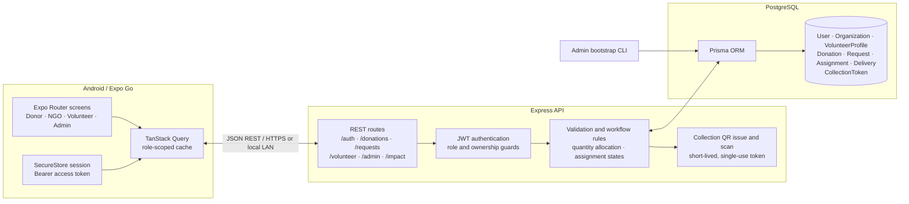
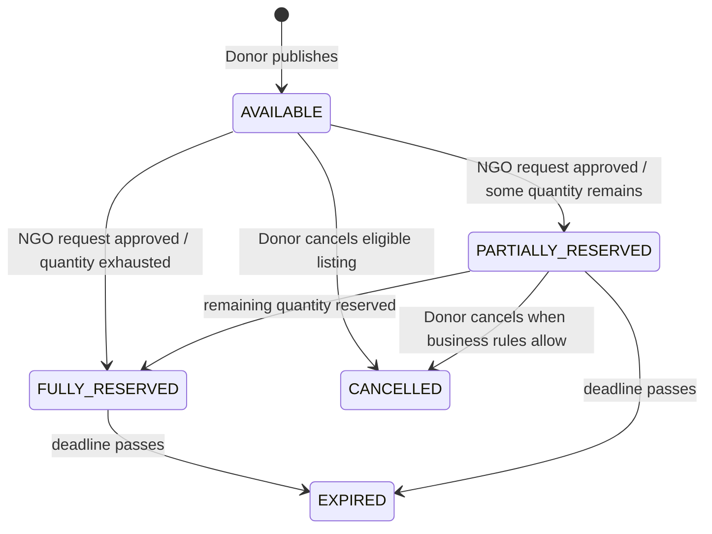

# RePlate Architecture

RePlate is a TypeScript monorepo with an Expo Router mobile client, an Express API, shared domain types, and PostgreSQL persistence through Prisma.

## Main data and trust boundaries

- The mobile app displays role-aware screens and sends authenticated API requests. SecureStore holds the access token; role and ownership authorization remain server-side.
- The Express API validates inputs and performs status/quantity changes. Reservation, QR consumption, and collection transitions use database transactions; the client does not decide authoritative quantities or workflow states.
- PostgreSQL is the system of record. Prisma migrations evolve the schema; QR tokens are stored as keyed hashes with assignment/volunteer binding, expiry, and one-use/revocation timestamps.
- Dashboard impact metrics aggregate real confirmed workflow rows and preserve each donation's original unit. Meal estimates use only documented meal/portion units; no unsupported environmental estimate is produced.
- The admin bootstrap is a local backend CLI action. Public registration cannot assign the Admin role.

## Donation lifecycle

An approved request follows `APPROVED → VOLUNTEER_ASSIGNED → COLLECTED → DELIVERED → COMPLETED`. At the collection transition, the assigned Volunteer scans the Donor's current QR. The server consumes the matching, unexpired token atomically; delivery and NGO confirmation then use the existing workflow.
